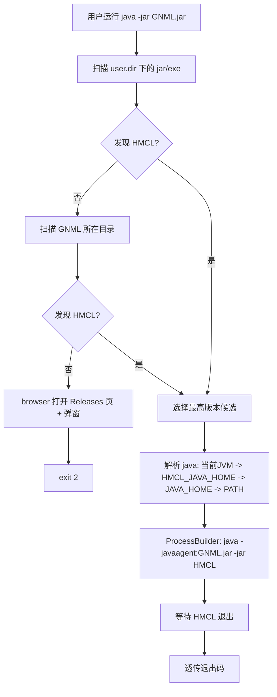

# Good Night Minecraft Launcher 技术设计文档

| 项目 | 内容 |
| --- | --- |
| 项目全名 | Good Night Minecraft Launcher（GNML） |
| 版本 | 0.1.0（设计基线） |
| 项目坐标 | `com.hexagram2021.gnml` |
| 许可证 | Artistic License 2.0（根目录 `LICENSE`） |
| 目标读者 | 开发者、评审者 |
| 状态 | 需求分析完成，待实现 |

## 1. 背景与目标

HMCL 启动器内部通过 `LocaleUtils.IS_CHINA_MAINLAND` 判断当前环境是否为中国大陆，并据此走不同的行为分支。GNML 的目标是使用 JavaAgent + ASM 技术，在运行时把 `org.jackhuang.hmcl.util.i18n.LocaleUtils#isChinaMainland()` 强制改为返回 `false`，使 HMCL 走"非中国大陆"逻辑，要求玩家先完成正版（Microsoft）登录，之后才能使用离线登录，帮助玩家遵守 Minecraft EULA。

### 1.1 目标

- G1：提供一个单一 jar 制品，双击或 `java -jar` 即可作为 HMCL 的引导启动器；
- G2：自动发现当前环境中的 HMCL 启动器（jar / exe），无 HMCL 时引导用户下载；
- G3：以 JavaAgent 方式挂载进 HMCL 进程，强制 `isChinaMainland()` 返回 `false`；
- G4：改造失败时拒绝启动 HMCL（fail-fast），杜绝"未经改造的 HMCL 被放行"。

### 1.2 非目标

- 不内置、不下载、不分发 HMCL 本体；
- 不修改磁盘上的 HMCL 文件（保护其数字签名）；
- 不提供 exe / deb 等系统制品；
- 不向 HMCL 透传命令行参数；
- 不覆盖 Minecraft 游戏进程（仅作用于 HMCL 自身 JVM）。

## 2. 需求澄清与决策记录

原始需求在评审中存在歧义，经与需求方确认后固化如下决策：

| 编号 | 原始需求点 | 歧义 / 风险 | 决策 |
| --- | --- | --- | --- |
| D1 | 制品为 jar，不打 exe / deb | — | 保持不变；Gradle `jar` 任务产出唯一可执行 jar |
| D2 | 扫描当前目录下 `*.exe` / `*.jar` | 用户可能在任意目录执行 `java -jar`，"当前目录"含义模糊 | 扫描两级：JVM 工作目录（`user.dir`）优先，未找到再扫 GNML 制品所在目录；均只扫一级，不递归 |
| D3 | Manifest `Main-Class` 为 `org.jackhuang.hmcl.Main` 判定 HMCL | 需处理 manifest 续行、编码 | 使用 `java.util.jar.JarFile#getManifest` 解析，`Main-Class` 精确匹配；`JarFile` 以 `verify=false` 打开，仅读不写 |
| D4 | 找到多个 HMCL 时如何选择 | 遍历顺序不稳定 | 从文件名解析版本号选最高版本；同版本优先 jar；版本全部无法解析时取文件名字典序最大者并输出警告 |
| D5 | 未找到 HMCL：打开浏览器 + 弹窗 | headless 环境无 GUI；浏览器可能打开失败 | `Desktop.browse` 失败时降级为弹窗展示 URL；`GraphicsEnvironment.isHeadless()` 时仅向 stderr 打印 URL；三种情况均以退出码 2 结束 |
| D6 | `java -javaagent:<GNML> HMCL.jar/.exe` 启动 | 该命令缺少 `-jar`，Java 无法以参数形式直接运行可执行 jar | 实际命令为 `java -javaagent:<GNML绝对路径> -jar <HMCL绝对路径>`；需求方知悉并认可 |
| D7 | `.exe` 也交给 `java` 启动 | 官方 HMCL.exe 为 Launch4j 包裹的 jar，ZIP 允许前置数据，`java -jar` 理论可行 | 支持直接 `-jar` 启动 exe；失败时报错并建议用户改用 jar（exe 实测为待验证项，见第 9 章） |
| D8 | 改造失败（未来 HMCL 改名等）时的行为 | 放行会破坏 G4 | fail-fast：命中目标类但未命中方法时抛出异常中止 JVM 启动 |
| D9 | java 可执行文件来源 | 系统可能装多个 JDK | 解析链：当前运行 GNML 的 JVM 同款 java → 环境变量 `HMCL_JAVA_HOME` → `JAVA_HOME` → 系统 `PATH` |
| D10 | 编译目标版本 | 项目以 Java 17 构建 | 参考 CME-Suck-My-Duck：`sourceCompatibility/targetCompatibility = 8` + `java.disableAutoTargetJvm()`，产出 Java 8 字节码，兼容带 JavaFX 的 JRE 8 |
| D11 | 项目坐标与许可证 | — | `com.hexagram2021.gnml`；Artistic License 2.0 |
| D12 | 文档语言 | — | README 面向用户、仅中文；本文档面向开发者、仅中文 |

## 3. 总体架构

同一 jar 承载两个入口，行为完全分离：`main` 负责发现与拉起 HMCL，`premain` 负责字节码改造；除共享常量（目标类名等）外不复用逻辑。



Premain 阶段（发生在 HMCL `main` 之前）：

```mermaid
flowchart TD
	P[premain 注册 ClassFileTransformer] --> Q[HMCL 类加载触发 transform]
	Q --> R{类名匹配 org/jackhuang/hmcl/util/i18n/LocaleUtils?}
	R -- 否 --> S[返回原始字节码]
	R -- 是 --> T{方法 isChinaMainland ()Z 存在?}
	T -- 否 --> U[抛异常, JVM 中止启动 fail-fast]
	T -- 是 --> V[方法入口注入 ICONST_0, IRETURN]
	V --> W[输出日志: 改造成功]
```

## 4. 详细设计

包结构（包名全小写，遵循项目命名规范）：

```
com.hexagram2021.gnml/
	package-info.java
	GoodNightMinecraftLauncher.java		// 唯一公共入口：main + premain
	launch/
		package-info.java
		HmclLocator.java				// 扫描与 Manifest 判定
		HmclCandidate.java				// 候选文件 + 解析出的版本
		HmclVersion.java				// 版本号值对象与比较
		JavaRuntimeLocator.java			// java 可执行文件解析链
		HmclProcessLauncher.java			// 子进程构建与等待
	notify/
		package-info.java
		UserNotifier.java				// 浏览器 + 弹窗 + headless 降级
	transform/
		package-info.java
		IsChinaMainlandTransformer.java	// ASM 转换器
	util/
		package-info.java
		GnmlLog.java					// stderr 日志，前缀 [GNML]
		GnmlConstants.java				// 目标类/方法/URL/退出码常量
```

因编译目标为 Java 8，全部实现禁止使用 Java 9+ 语法与 API（`var`、record、文本块、`List.of` 等）。

### 4.1 GoodNightMinecraftLauncher

```java
public final class GoodNightMinecraftLauncher {
	/**
	 * 引导入口：发现 HMCL 并以 javaagent 方式拉起喵~
	 *
	 * @param args 不接受任何参数；收到参数时打印用法并以退出码 1 结束
	 */
	public static void main(String[] args) {
		if (args.length > 0) {
			GnmlLog.error("GNML 不支持命令行参数");
			System.exit(GnmlConstants.EXIT_USAGE);
		}
		// 1. 定位 HMCL -> 2. 定位 java -> 3. 启动子进程 -> 4. 透传退出码
	}

	/**
	 * JavaAgent 入口：仅注册字节码转换器，不做扫描与 UI 喵~
	 *
	 * @param agentArgs 预留的 agent 参数，当前版本忽略
	 * @param inst      Instrumentation 实例
	 */
	public static void premain(String agentArgs, Instrumentation inst) {
		inst.addTransformer(new IsChinaMainlandTransformer());
		// 无需 retransform：premain 先于 HMCL 任何类加载执行
	}
}
```

要点：

- `premain` 不复用 `main` 的任何扫描/UI 逻辑，满足"Main 和 Premain 执行行为完全不同"；
- 未声明 `Agent-Class`，不支持动态 attach（`agentmain`）；
- 不启用 retransform：premain 先于 HMCL 任何类加载执行，依赖自然的类加载时机即可，无需 `retransformClasses`；且部分 JVM 环境不支持可 retransform 的注册（`addTransformer(transformer, true)` 会抛 `UnsupportedOperationException`，实现阶段实测，见附录 C）。

### 4.2 HmclLocator

职责：按 D2 的两级目录顺序扫描，返回唯一 HMCL 候选或空。

- 过滤条件：一级目录下的常规文件，扩展名大小写不敏感地匹配 `jar` / `exe`；
- 判定：`new JarFile(file, false)` 读取 manifest，`Main-Class` 与 `org.jackhuang.hmcl.Main` 精确比较；
- 防御：单个文件打开失败（非 zip、权限、损坏）记 WARN 后跳过，不中断扫描；GNML 自身 jar 会被自然排除（其 `Main-Class` 不匹配）；
- 排序：见 4.3；返回排序后的最优候选。

### 4.3 HmclVersion

版本解析与比较规则：

1. 先剥离文件名末尾的 `.jar` / `.exe` 扩展名（否则预发布后缀会把扩展名吞入，如 `3.17.0-beta.1.jar`，实测缺陷见附录 C），再取第一个匹配 `(\d+(?:\.\d+)*)([-+][A-Za-z0-9.\-+]+)?` 的片段，如 `HMCL-3.16.4.jar` → 数字部分 `[3,16,4]`，预发布后缀无；
2. 比较：逐段比较数字，缺失段补 0；数字段相同时，无预发布后缀者 > 有后缀者；两侧均有后缀时按字典序比较；
3. 文件名无法解析出版本的候选视为最低优先级；全部无法解析时取文件名字典序最大者并输出 WARN。

同数字版本的 jar 与 exe 并存时，jar 优先（更接近需求中的主路径，且不依赖 Launch4j 兼容性）。

### 4.4 JavaRuntimeLocator

按 D9 顺序解析 java 可执行文件，返回绝对路径，解析失败返回空：

| 顺序 | 来源 | 解析方式 |
| --- | --- | --- |
| 1 | 当前 JVM 同款 | `System.getProperty("java.home")` + `bin/java`（Windows 附加 `.exe` 校验存在性） |
| 2 | `HMCL_JAVA_HOME` | 环境变量指向 JDK/JRE 根目录，取其 `bin/java` |
| 3 | `JAVA_HOME` | 同上 |
| 4 | 系统 `PATH` | 直接使用命令 `java`（依赖 `ProcessBuilder` 的 PATH 解析） |

每一步均校验 `bin/java` 存在且为常规文件；解析结果写入日志（含来源），便于排障。可选轻量校验：以 `java -version` 确认可执行，失败则进入下一来源。

### 4.5 HmclProcessLauncher

```java
List<String> command = Arrays.asList(
	javaPath, "-javaagent:" + gnmlJarAbsolutePath, "-jar", hmclFileAbsolutePath);
Process process = new ProcessBuilder(command)
	.directory(workingDir)	// 与 GNML 相同的工作目录，保证 HMCL 相对路径语义不变
	.inheritIO()			// HMCL 的控制台输出直接透传给用户
	.start();
int exitCode = process.waitFor();
System.exit(exitCode);
```

- 工作目录继承自 GNML 进程；
- `inheritIO` 避免输出缓冲与死锁，且 HMCL 日志直接可见；
- `waitFor` 期间 GNML 不退出；`InterruptedException` 时先恢复中断位再以退出码 1 结束；
- 路径一律取绝对路径后传入，避免 `-javaagent` 相对路径在子进程中的歧义。

### 4.6 UserNotifier

- `Desktop.isDesktopSupported() && Desktop.getDesktop().isSupported(Desktop.Action.BROWSE)` 时打开 `https://github.com/HMCL-dev/HMCL/releases`；
- 浏览器打开失败或 headless 时的降级矩阵见 D5；
- 弹窗使用 `JOptionPane`（WARNING_MESSAGE）构建 `JDialog`，并 `setAlwaysOnTop(true) + toFront()`：浏览器打开后会抢焦点并遮挡普通窗口，置顶确保用户能看到引导（实现阶段实测问题，见附录 C）；
- GUI 相关代码全部延迟到需要时才触发类加载，避免影响 headless 场景的类初始化。

### 4.7 IsChinaMainlandTransformer

目标（基于 HMCL 3.16.4 实测，见附录 A）：

| 项 | 值 |
| --- | --- |
| 目标类 | `org/jackhuang/hmcl/util/i18n/LocaleUtils` |
| 目标方法 | `isChinaMainland`，描述符 `()Z`，`private static` |
| 调用点 | `<clinit>` 中 `putstatic IS_CHINA_MAINLAND` 之前 |
| 改写方式 | 整体替换方法体为 `ICONST_0; IRETURN`（maxStack=1，maxLocals=0） |

设计要点：

- 采用 `ClassReader` + `ClassWriter(reader, 0)` 的拷贝式写入，未命中的方法原样保留，不使用 `COMPUTE_MAXS | COMPUTE_FRAMES`；
- **不能**仅在方法入口插入 `ICONST_0; IRETURN` 保留原始代码：HotSpot 栈图验证器要求无条件跳转之后的指令必须有 StackMapTable 帧，残留死代码会触发 `VerifyError`（实现阶段实测，见附录 C）。因此由 `AlwaysFalseMethodVisitor` 丢弃全部原始指令、标签、栈图、异常表与行号，只写出两字节的新方法体，产物为无分支的极简字节码，不需要任何帧；
- 由于 `IS_CHINA_MAINLAND` 是非编译期常量（由 `<clinit>` 调用方法赋值），HMCL 任何位置对它的读取都会触发 `<clinit>` 并拿到改造后的 `false`；
- fail-fast（D8）：类名匹配但方法未命中时，抛出 `IllegalClassFormatException` 并附带该类实际方法列表摘要。HotSpot 会将转换异常转为类加载错误，HMCL 随即启动失败，实现"不放行"语义；
- `transform` 捕获 ASM 侧异常后同样按上一条处理，绝不返回原始字节码兜底；
- 成功命中时向 stderr 输出 `[GNML] 已将方法体替换为 return false: isChinaMainland()Z`，作为用户可感知的生效凭据。

## 5. 构建与打包

### 5.1 Gradle 配置要点

```gradle
plugins {
	id 'java'
}

group = 'com.hexagram2021.gnml'
version = '0.1.0'

compileJava {
	sourceCompatibility = 8
	targetCompatibility = 8
}
java.disableAutoTargetJvm()

dependencies {
	compileOnly 'com.google.code.findbugs:jsr305:3.0.2'	// @Nullable，CLASS 保留，无需随制品分发
	implementation 'org.ow2.asm:asm:9.7'
}

jar {
	manifest {
		attributes([
			"Main-Class"   : "com.hexagram2021.gnml.GoodNightMinecraftLauncher",
			"Premain-Class": "com.hexagram2021.gnml.GoodNightMinecraftLauncher",
			"Implementation-Title": "Good Night Minecraft Launcher",
			"Implementation-Version": project.version
		])
	}
	// ASM 必须打入制品：HMCL jar 内不含 org.objectweb.asm（实测 3.16.4）
	from({ configurations.runtimeClasspath.collect { zipTree(it) } }) {
		exclude 'META-INF/**'
	}
}
```

关键依据：

- **必须 shade ASM**：实测 HMCL 3.16.4 jar 不包含 `org/objectweb/asm/*`；agent jar 是运行时唯一的类来源，未打入将直接 `NoClassDefFoundError`；
- Manifest 同时声明 `Main-Class` 与 `Premain-Class`（参考 CME-Suck-My-Duck 的做法）；不需要 `Can-Redefine-Classes` / `Can-Retransform-Classes`（未使用 retransform），保留 `retransform` 语义的开关为 false，减少权限面；
- 编译目标 Java 8 与 CME-Suck-My-Duck 一致（D10）；构建本身使用 Java 17 工具链，`--release`/`disableAutoTargetJvm` 组合在实现阶段验证；
- 制品命名 `GNML-<version>.jar`。

### 5.2 许可与声明

- 根目录 `LICENSE`（Artistic License 2.0）打入 jar 根；
- README 声明与 Mojang / Microsoft / HMCL 开发组无关联；
- 不包含任何 Mojang 或 HMCL 资产。

## 6. 错误处理与退出码

| 退出码 | 含义 | 触发场景 |
| --- | --- | --- |
| 0 | 成功 | HMCL 正常退出且其退出码为 0 |
| 1 | 通用错误 / 用法错误 | 收到不支持的参数、未知内部异常 |
| 2 | 未找到 HMCL | 两级目录均无匹配，已引导用户下载 |
| 3 | java 解析失败 | 解析链 4 个来源全部失败 |
| 其他 | 透传 | HMCL 子进程的原始退出码 |

- 所有异常均带上下文信息（文件路径、目录、来源）输出到 stderr，前缀 `[GNML]`；
- 预期内场景（单个文件无法打开、浏览器打开失败）降级处理，不终止主流程；
- 预期外异常在 `main` 顶层兜底捕获，输出堆栈后以退出码 1 结束。

## 7. 兼容性

| 维度 | 基线 | 说明 |
| --- | --- | --- |
| GNML 运行时 | JRE/JDK 8+ | Java 8 字节码；建议带 JavaFX 的发行版（Liberica Full、Zulu FX、Oracle 8） |
| HMCL | 3.16.4（实测） | 其他版本取决于 `LocaleUtils#isChinaMainland` 是否存在，失败即 fail-fast |
| 操作系统 | Windows / macOS / Linux | 纯 Java 实现；Windows 的 `.exe` 后缀在 `java` 解析时附加 |
| JVM 厂商 | HotSpot 系（Liberica、Temurin、Zulu、Oracle） | 转换异常转类加载错误的行为以 HotSpot 为准 |

## 8. 测试策略与验收标准

### 8.1 单元测试（JUnit 5）

| 测试对象 | 用例要点 |
| --- | --- |
| HmclVersion | 数字段比较、补零（3.16 vs 3.16.0）、预发布低于稳定版、无法解析版本的降级 |
| HmclLocator | 用 `JarOutputStream` 构造临时 zip（含正确/错误/缺失 manifest、续行 manifest）；jar/exe 同版本优先 jar；非 zip 文件跳过 |
| JavaRuntimeLocator | 以可注入的环境变量提供器测试回退顺序与缺失场景 |
| IsChinaMainlandTransformer | 对 `references/LocaleUtils.java` 编译出的最小替身类做转换，断言转换后字节码在入口直接返回 false；对无目标方法的类断言抛出异常 |

### 8.2 集成验证（不入库，使用本机真实 HMCL）

以 `C:\Users\liudongyu\Downloads\HMCL-3.16.4.jar` 为被测对象：

1. 无 agent：`java -cp HMCL-3.16.4.jar VerifyMain`，在 `Asia/Shanghai` 时区反射读取 `LocaleUtils.IS_CHINA_MAINLAND` 应为 `true`；
2. 有 agent：`java -javaagent:GNML-0.1.0.jar -cp HMCL-3.16.4.jar VerifyMain`，同一读取应为 `false`，且 stderr 出现 `[GNML]` 生效日志；
3. 端到端：GNML 与 HMCL 同目录运行，HMCL 界面正常启动、可正常登录；
4. 异常路径：空目录运行触发浏览器 + 弹窗且退出码 2；伪造一个含 `Main-Class: org.jackhuang.hmcl.Main` 但不含 `LocaleUtils` 的 jar，断言启动中止。

### 8.3 验收标准

- A1：空目录双击运行 → 打开 HMCL Releases 页 + 警告弹窗，退出码 2；
- A2：目录含单个 HMCL jar → HMCL 以 agent 启动；上海时区下 `IS_CHINA_MAINLAND` 读取为 false；
- A3：目录含 `HMCL-3.15.0.jar` 与 `HMCL-3.16.4.jar` → 选择 3.16.4；
- A4：同版本 jar 与 exe 并存 → 选择 jar；
- A5：目标方法缺失 → HMCL 启动中止，无 HMCL 窗口出现；
- A6：java 解析链按 D9 顺序回退，全部失败时退出码 3；
- A7：HMCL 内退出后，GNML 退出码与 HMCL 一致；
- A8：产物为单一 `GNML-0.1.0.jar`，无外部依赖，双击可运行。

## 9. 风险与应对

| 风险 | 影响 | 应对 |
| --- | --- | --- |
| HMCL 重构移除 / 改名 `isChinaMainland` | 改造失败，HMCL 无法通过 GNML 启动 | fail-fast + 方法列表日志；README 引导用户关注 GNML 更新 |
| HMCL.exe（Launch4j）无法被 `java -jar` 运行 | D7 场景不可用 | 已将 exe 实测列为实现阶段验证项；不可用时文档引导用户下载 jar |
| 用户 JRE 无 JavaFX | HMCL 界面无法启动（与 GNML 无关） | README 明确推荐发行版；必要时在启动前以 `java -version` 输出辅助排障 |
| Java 8 字节码限制实现手段 | 无法使用现代语法/API | 代码评审阶段把关；CI 以 `--release 8` 编译兜底 |
| 恶意构造的 zip 触发解析异常 | 扫描中断 | 单文件 try-with-resources + WARN 跳过 |
| `waitFor` 期间 HMCL 弹出 UAC/子进程 | 无影响 | HMCL 游戏进程独立于本进程，无需跟踪 |

## 10. 后续演进（非本版本范围）

- 配置文件（如 `gnml.properties`）支持自定义 HMCL 路径与 java 路径；
- 命令行参数透传与 `--hmcl <path>` 显式指定；
- `agentmain` 动态 attach 支持；
- 对 HMCL 多版本并存时的启动选择 UI。

## 附录 A：HMCL 3.16.4 实测记录

- 文件：`C:\Users\liudongyu\Downloads\HMCL-3.16.4.jar`（10,453,287 字节）；
- Manifest：`Main-Class: org.jackhuang.hmcl.Main`，`Implementation-Version: 3.16.4`，`Multi-Release: true`，含 `META-INF/hmcl_signature`（签名 jar）；
- 类与方法：`org/jackhuang/hmcl/util/i18n/LocaleUtils.class` 存在；`private static boolean isChinaMainland();` 存在；`<clinit>` 中 `invokestatic isChinaMainland()Z` 后 `putstatic IS_CHINA_MAINLAND:Z`；
- 字节码版本：`org/jackhuang/hmcl/Main.class` major version 52（Java 8）；
- 依赖：jar 内不含 `org/objectweb/asm/*`，agent 必须自带 ASM。

## 附录 B：参考实现

- `references/LocaleUtils.java`：需求方提供的 HMCL 源码快照；
- `C:\Projects\CME-Suck-My-Duck`：premain + ClassFileTransformer + ASM 注入的参考项目，本设计沿用其入口结构与 Gradle 字节码目标策略。

## 附录 C：实现偏差与验证记录

实现阶段对设计做了四处经实测驱动的修正，均已回写正文：

| 编号 | 原设计 | 实测问题 | 修正 |
| --- | --- | --- | --- |
| C1 | 方法入口插入 `ICONST_0; IRETURN`，保留原始代码为死代码 | HotSpot 栈图验证器要求无条件跳转后的指令必须有 StackMapTable 帧，`VerifyError: Expecting a stack map frame` | 由 `AlwaysFalseMethodVisitor` 整体替换方法体，丢弃原始指令/标签/栈图/异常表（4.7） |
| C2 | `addTransformer(transformer, true)`（沿用 CME） | `UnsupportedOperationException: adding retransformable transformers is not supported in this environment` | 改为普通 `addTransformer(transformer)`；premain 本就无需 retransform（4.1） |
| C3 | 文件名直接正则匹配版本 | 预发布后缀吞入扩展名：`HMCL-3.17.0-beta.1.jar` 解析为 `3.17.0-beta.1.jar` | 解析前先剥离 `.jar` / `.exe` 扩展名（4.3） |
| C4 | `JOptionPane.showMessageDialog` 普通弹窗 | 浏览器打开后抢焦点并遮挡弹窗，用户实际看不到警告窗口 | `JDialog.setAlwaysOnTop(true) + toFront()`（4.6） |

验证记录（2026-10-20，Windows 11，Liberica JDK 17）：

- 单元测试：20/20 通过（`gradlew build` 全绿）；
- E2E-A/B（真实 HMCL-3.16.4.jar + 反射探针）：不带 agent `IS_CHINA_MAINLAND=true`；带 agent `=false`，stderr 出现 `[GNML] 已将方法体替换为 return false: isChinaMainland()Z`；
- E2E-C（空目录 + headless）：stderr 输出扫描目录与下载地址，退出码 2；
- E2E-D（伪造 HMCL jar 全链路）：发现（版本 9.9.9）→ java 解析（CURRENT_JVM）→ 子进程挂 agent → `FAKE_HMCL_STARTED` → 退出码 0 透传；
- E2E-GUI（用户实测）：未找到 HMCL 时浏览器正确打开 Releases 页面（弹窗置顶修正后待用户复核）；
- 制品检查：`gnml-0.1.0.jar` 含 `NOTICE.md`、`LICENSE`（根目录）、shaded ASM，入口类 major version 52。

构建环境备注：本机 `services.gradle.org` 与 Maven Central 需走本机代理（`GRADLE_OPTS` 注入 `-Dhttps.proxyHost/Port`）；沙箱内无法写用户主目录，故以工作区 `.gradle-user-home` 作为 `GRADLE_USER_HOME`（已加入 .gitignore）。
